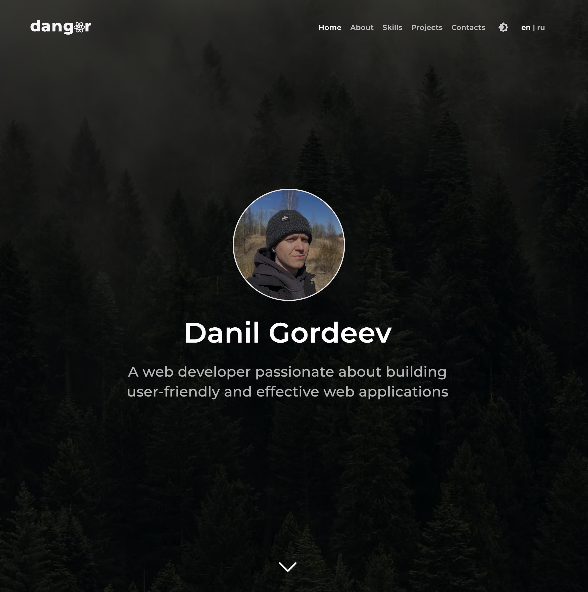

<a id="readme-top"></a>

<!-- PROJECT LOGO -->

[](https://github.com/dangor220/dangor/blob/main/README.md)

<br />

<div align="center">

<a href="https://github.com/dangor220/dangor/tree/main/src">
  
</a>

### Danil Gordeev — Frontend Developer

Personal portfolio website showcasing professional experience, technical skills, and completed projects.

[Visit website](https://www.dangor.ru/) · [Source code](https://github.com/dangor220/dangor)

</div>

## Preview



## About

**dangor** is a personal portfolio website built with React and TypeScript using Vite.

The website presents the developer's professional profile, including education, work experience, technical skills, and completed projects.

The interface supports English and Russian languages, light and dark themes, responsive layouts, and interactive navigation between sections.

## Tech Stack

[](https://react.dev/)
[](https://www.typescriptlang.org/)
[](https://vite.dev/)
[](https://sass-lang.com/)

- React Router
- i18next
- Material UI
- CSS Modules
- PDF.js

```

```
