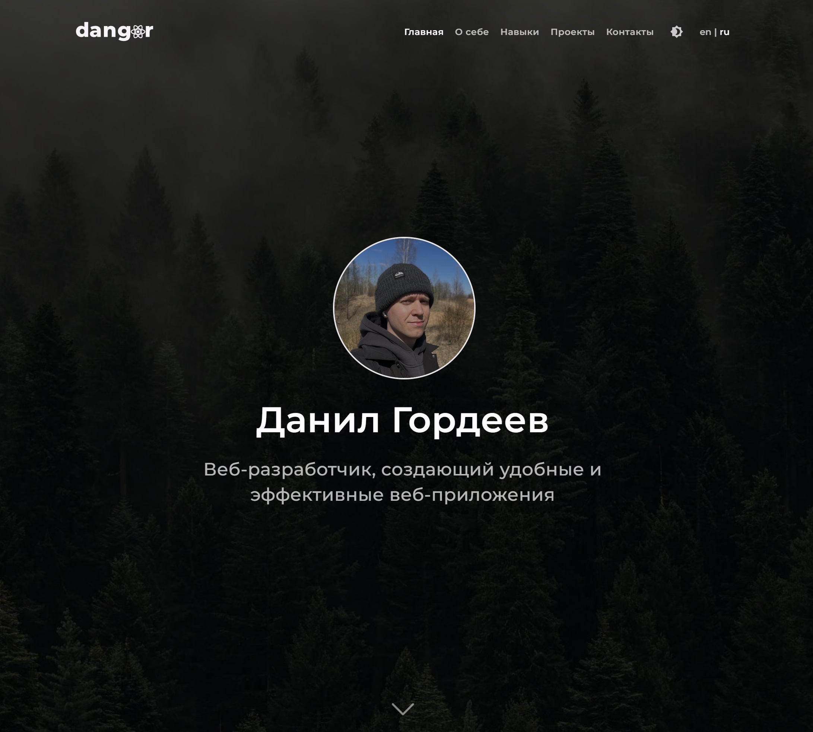

# dangor — Personal Portfolio

### Данил Гордеев — Frontend Developer

Персональный сайт-портфолио, созданный для презентации профессионального опыта, технических навыков и реализованных проектов.

[Открыть сайт](https://www.dangor.ru/) · [Исходный код](https://github.com/dangor220/dangor)

## Preview

## About

**dangor** — персональное веб-портфолио, разработанное на React и TypeScript с использованием Vite.

Сайт представляет профессиональный профиль разработчика, включая информацию об образовании, опыте работы, технических навыках и реализованных проектах.

Интерфейс поддерживает русский и английский языки, светлую и тёмную темы оформления, адаптивную верстку и интерактивную навигацию между секциями.

## Tech Stack

- React Router
- i18next
- Material UI
- CSS Modules
- PDF.js
